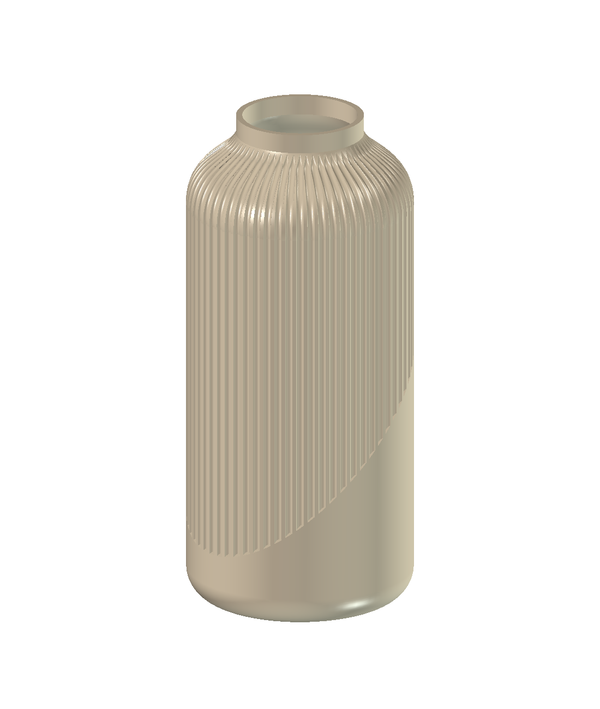

# Test: crear un jarrón en FreeCAD desde una imagen

Documenta una réplica del test mostrado en un video, usando la misma imagen de referencia, según lo indicado por quien realizó la prueba. La conversación revisada contiene un único pedido para crear el modelo y una ejecución de Codex que terminó con archivos CAD y una vista previa. No se proporcionó el enlace del video; no se evaluó el resultado del autor original ni se verificó independientemente que ambas imágenes fueran idénticas.




## Resultado y evaluación

Codex utilizó GPT-6.1 Sol con esfuerzo de razonamiento medio y el MCP de FreeCAD. El entorno registró FreeCAD 1.1.4. El turno duró aproximadamente **12 min 23 s**, incluida la generación, las revisiones y la exportación; no corresponde únicamente al tiempo de cálculo de geometría.

Se obtuvo un jarrón hueco con hombro redondeado, cuello abierto, base cerrada, 64 acanaladuras y una zona lisa que asciende alrededor del cuerpo. La vista previa reproduce los rasgos principales de la referencia. No se midió la similitud visual: cambian la perspectiva, el acabado y la forma exacta de la transición. Las dimensiones fueron elegidas por Codex porque la fotografía no tiene escala.

| Parámetro nominal | Valor |
|---|---:|
| Altura | 320 mm |
| Diámetro del cuerpo antes del acanalado | 144 mm |
| Diámetro exterior de la boca | 81 mm |
| Diámetro interior de la boca | 73 mm |
| Pared nominal antes de las ranuras | 4 mm |
| Espesor del fondo | 5 mm |
| Acanaladuras | 64 |
| Profundidad máxima prevista de ranura | 1,8 mm |

El diámetro indicado es nominal; no es una nueva medición independiente del archivo. El espesor de pared se reduce en las ranuras y no se verificó su mínimo global.

## Qué ocurrió durante la sesión

1. Codex interpretó la imagen y eligió dimensiones aproximadas, sin preguntas adicionales al usuario.
2. Construyó un perfil cerrado de pared y fondo y lo revolucionó. Generó herramientas de corte para las acanaladuras y las recortó mediante un plano inclinado.
3. Ajustó la base redondeada, la orientación de la banda y las ranuras rectas. Hubo varias reconstrucciones. Una versión intermedia produjo una herramienta booleana inválida y falló una comprobación del fondo, aunque el sólido final de esa versión figuraba como válido.
4. Corrigió la construcción de las herramientas recortando cada ranura por separado. La última ejecución terminó sin error y superó las comprobaciones del fondo y de la cavidad.
5. Abrió el modelo final en FreeCAD, verificó 64 herramientas válidas, un sólido válido, fondo cerrado y cuerpo y boca huecos; guardó el FCStd, exportó STEP y generó la vista previa.

Esto demuestra por qué el resultado de `isValid()` por sí solo no bastaba: se añadieron comprobaciones funcionales sobre el interior y el fondo. La evidencia es el registro de la sesión y el archivo de validación producido entonces. En esta revisión se inspeccionaron dichos registros, el código, los archivos y las imágenes; no se volvió a ejecutar el modelado ni a abrir el CAD en FreeCAD.

La validación final guardada reporta **1 sólido válido**, **331 caras** y **524.589,851944 mm³ de volumen de material**. No se hizo impresión física, prueba de estanqueidad, análisis estructural ni evaluación completa de fabricación.

## Tokens y costo estimado

Reporte ejecutado el 3 de octubre de 2026 con **ccusage 20.0.26**, sobre la sesión completa. El modelo fue reconocido sin usar un modelo alternativo de respaldo.

| Categoría | Tokens |
|---|---:|
| Entrada sin caché | 30.670 |
| Entrada en caché | 865.152 |
| Salida | 10.541 |
| **Total acumulado** | **906.363** |

Los 3.985 tokens de razonamiento ya están incluidos en los 10.541 de salida. No deben sumarse otra vez. Aproximadamente el 96,58 % de los tokens de entrada fueron leídos desde caché.

**Costo estimado equivalente de API: US$0,2532652, aproximadamente US$0,25.** Es el cálculo que devolvió ccusage con sus tarifas disponibles. No es un cargo adicional de la suscripción, una factura ni una medida exacta de los créditos del plan. No se auditaron independientemente las tarifas de GPT-6.1 Sol utilizadas por la herramienta.

El cálculo separa entrada sin caché, entrada en caché y salida, aplicando sus respectivas tarifas por millón de tokens. El total acumulado incluye las llamadas repetidas durante la conversación, por lo que difiere de la ocupación de contexto que muestra `/status`.

Para reproducir el reporte en el equipo donde exista el registro original:

```powershell
npx ccusage@20.0.26 codex session --id ID_DE_LA_SESION --json
```

El identificador real se omitió de este paquete. Documentación: [ccusage en GitHub](https://github.com/ccusage/ccusage), [reportes por sesión](https://ccusage.com/guide/session-reports) y [cálculo para Codex](https://github.com/ccusage/ccusage/blob/main/docs/guide/codex/index.md).

## Archivos incluidos

| Archivo | Contenido |
|---|---|
| [conversacion.md](conversacion.md) | Exportación detallada: mensajes, comandos, llamadas MCP y resultados, con rutas anonimizadas |
| [Fluted_Reference_Vase.FCStd](Fluted_Reference_Vase.FCStd) | Modelo nativo de FreeCAD con árbol de construcción |
| [Fluted_Reference_Vase.step](Fluted_Reference_Vase.step) | Geometría exportada para otros sistemas CAD |
| [Vase_Preview.png](Vase_Preview.png) | Vista del resultado, sin metadatos de texto |
| [reference.jpg](reference.jpg) | Imagen de referencia adjunta al pedido |
| [build_vase.FCMacro](build_vase.FCMacro) | Código final adaptado para ejecutarse sin rutas personales |
| [validation.json](validation.json) | Resultado de validación guardado por la sesión |
| [usage_ccusage.json](usage_ccusage.json) | Métricas del reporte, con identificadores eliminados |

Para regenerar el modelo, abrir `build_vase.FCMacro` desde el menú de macros de FreeCAD y ejecutarlo desde una carpeta escribible. Guardará FCStd, STEP y `validation.json` en la carpeta de la macro y sobrescribirá archivos de esos nombres. La vista previa no se regenera con esta macro. La adaptación de rutas fue inspeccionada, pero no se ejecutó durante esta revisión.

El perfil y las operaciones están en el documento nativo. La hoja de dimensiones documenta los supuestos; editarla no actualiza automáticamente las acanaladuras. Para modificar su distribución se debe ajustar y ejecutar la macro.

## Preparación para compartir

Se eliminaron rutas personales, nombre de usuario del equipo e identificador de sesión de los materiales de publicación. Se limpiaron campos de autor, empresa y fechas exactas del documento nativo; se normalizaron las marcas de tiempo del contenedor y del encabezado STEP y se retiraron los metadatos de texto de la vista previa. La referencia no tenía EXIF. Se conservaron sin cambios los datos geométricos BREP y los píxeles de ambas imágenes.